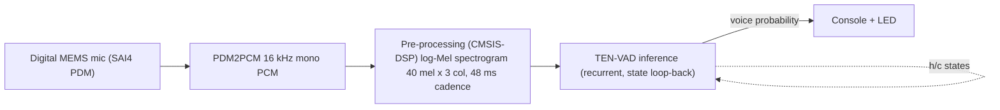

# x-cube-h7-ai-vad

This project provides an embedded real-time environment for STM32 microcontrollers
to run a model generated by [ST Edge AI](https://www.st.com/en/development-tools/stedgeai-core.html)
for audio applications. The purpose of this package is to stream physical data
acquired by sensors into a processing chain made of a preprocessing step, which
typically performs a first level of feature extraction, followed by the machine
learning inference itself. The results are then exposed to the user in real time
through a serial console.
Only a bare-metal version is implemented.

Two variants of the TEN-VAD model are available:

- `full` (default): fully quantized model.
- `partial`: partially quantized model.

## Table of Contents

- [Hardware and Software environment](#hardware-and-software-environment)
  - [Hardware support](#hardware-support)
  - [Serial port configuration](#serial-port-configuration)
  - [Toolchains support](#toolchains-support)
- [Quickstart using prebuilt binary](#quickstart-using-prebuilt-binary)
- [Quickstart using Source Code](#quickstart-using-source-code)
  - [Makefile](#makefile)
  - [STM32CubeIDE](#stm32cubeide)
  - [Low-latency mode (default)](#low-latency-mode-default)
  - [LCD-less builds](#lcd-less-builds)
- [Typical Output on uart console](#typical-output-on-uart-console)
- [Configuration](#configuration)
  - [Application](#application)
  - [Model input pre-processing configuration](#model-input-pre-processing-configuration)
- [Pre-processing and AI-inference performance on Cortex-M7](#pre-processing-and-ai-inference-performance-on-cortex-m7)
- [Debug build and flashing](#debug-build-and-flashing)
- [Regenerating the model](#regenerating-the-model)
- [How to update my project with a new version of ST Edge AI](#how-to-update-my-project-with-a-new-version-of-st-edge-ai)

## Hardware and Software environment

### Hardware support

- [STM32H747I-DISCO](https://www.st.com/en/evaluation-tools/stm32h747i-disco.html)
Discovery board (Cortex-M7 only; the Cortex-M4 core is held in an infinite loop
and is not used by this application).

Audio is acquired from the on-board digital MEMS microphone(s) (SAI4 in PDM
mode + PDM2PCM software decoding), so no expansion board is required. Connect
the board to your computer with a USB cable on the ST-LINK USB connector
(CN2).

**NOTE**: the STM32H747I-DISCO does not have an ADF (Audio Digital Filter), so
it cannot be used for audio capture in this project. More recent products of the
STM32H7 family do have one. It enables a low-power mode by filtering the audio
signal before it reaches the core functions of the application, waking the CPU
only when necessary.

### Serial port configuration

This package outputs results and useful information (depending on the configured
level of verbosity) through the ST-LINK Virtual COM Port (USART1). The default
configuration of the serial link is:

- Speed = 115200 baud
- Data = 8 bits
- Parity = None
- Stop bits = 1
- Flow control = None

### Toolchains support

- [STM32CubeProgrammer](https://www.st.com/en/development-tools/stm32cubeprog.html) **v2.22.0**
- [STM32CubeIDE](https://www.st.com/en/development-tools/stm32cubeide.html) **v2.1.1**
- [STEdgeAI](https://www.st.com/en/development-tools/stedgeai-core.html) **v4.1.0**

## Quickstart using prebuilt binary

The project provides the following use case:

- Voice Activity Detection (VAD): continuously estimating the probability
  that the current audio frame contains human speech, using the TEN-VAD
  recurrent model.



One binary is provided in the `Binary` directory. Program it into the board's
internal flash as follows:

  1. Install STM32CubeProgrammer on your system.
  2. Add `STM32_Programmer_CLI` to your PATH.
  3. Program the board with
    `STM32_Programmer_CLI -c port=swd -w Binary/x-cube-h7-ai-vad.elf`
  4. Reset the board.

## Quickstart using Source Code

### Makefile

Alternatively, build from source with the provided `Makefile` (this requires the
`arm-none-eabi` GCC toolchain),
then flash the resulting `Debug/x-cube-h7-ai-vad.elf`:

```bash
make clean && make                    # Debug, full model (default)
make clean && make AI_MODEL=partial   # Debug, partial model
make clean && make DEBUG=0            # Release, full model
```

Always run `make clean` when changing `AI_MODEL`, `EXTRA_DEFS` or any other
build option passed on the command line: existing object files do not record
the include path or compiler options they were built with, so `make` would not
recompile them and the resulting firmware would silently mix the old and new
configurations. The resulting ELF can be identified by its
aligned weight-array symbol: 286,800 bytes for `partial`, 78,928 bytes for
`full`.

### STM32CubeIDE

Or import [STM32CubeIDE/CM7](STM32CubeIDE/CM7) (`File > Import > Existing
Projects into Workspace`). `Debug` and `Release` build the default `full`
model; `Debug Partial` and `Release Partial` build the `partial` model. The CM4
core only needs to be built with [STM32CubeIDE/CM4](STM32CubeIDE/CM4) if you
also intend to debug it (its image is a minimal boot stub, gated off by
default).

### Low-latency mode (default)

TEN-VAD is trained on a window sliding one hop at a time. By default
(`APP_LOW_LAT`), the feature front-end therefore computes only the newest mel
column at each 16 ms acquisition event, which feeds the recurrent state at the
cadence it was trained for. Opting out recomputes all 3 mel columns from
scratch every 48 ms and advances the recurrent state once per 3 frames instead
of once per frame:

```bash
make clean && make EXTRA_DEFS=-DAPP_LOW_LAT_OFF
```

When building from STM32CubeIDE, add `APP_LOW_LAT_OFF` to the CM7 project's
preprocessor symbols (`Project > Properties > C/C++ Build > Settings >
MCU/MPU GCC Compiler > Preprocessor > Define symbols (-D)`, for the build
configuration you use) and rebuild.

### LCD-less builds

`APP_LCD` (display support: assets, BSP, fonts) is on by default and costs
~136 KB of FLASH. Opt out for boards without a display, or to save FLASH:

```bash
make clean && make EXTRA_DEFS=-DAPP_LCD_OFF
```

When building from STM32CubeIDE, add `APP_LCD_OFF` to the CM7 project's
preprocessor symbols in the same way as `APP_LOW_LAT_OFF` above.

## Typical Output on uart console

Start the application by pressing the reset button on the board. The application
sends logs to the PC serial console through the ST-LINK USB cable (you may use
[Tera Term](https://teratermproject.github.io/index-en.html)).
In the Tera Term terminal configuration, set the receive newline to CR.

The welcome screen displays the system configuration and the status of the
inference processing:

```Terminal
========================================
x-cube-h7-ai-vad v1.2.0
Build date & time: Aug  4 2026 10:00:00
Compiler: GCC 12.3.1
HAL: 1.11.6
STEdgeAI Tools: 4.1.0
NN model: tenvadfixed_dec_partial_qdq_w8a8
========================================

---------------------------------------------------------------
        System configuration (Bare Metal)
---------------------------------------------------------------

Log Level: Info

Compiled with GCC 12.3.1
STM32 device configuration...
 Device       : DevID:0x0450 (STM32H747/H757/H743/H753) RevID:0x2003
 Core Arch.   : M7 - FPU  used
 HAL version  : 0x010B0600
 SYSCLK clock : 400 MHz
 HCLK clock   : 200 MHz
 I-Cache      : True
 D-Cache      : True

---------------------------------------------------------------


ST.AI RT
---------------------------------------------------------------
 tools version   : v4.1.0
 network rt lib  : v12.1.0
   compiled with : GCC 13.3.1

Network informations...
 model signature : 0x013559222345a648d46dbda1ea007205
 c-name          : network
 c-signature     : 0
 c-datetime      : 2026-08-05T18:18:02+0200
 c-compile-time  : Aug  4 2026 10:00:00
 macc            : 90091
 runtime version : 12.1.0
 n_inputs : 5 (allocate-inputs)
  i[0]  (1,3,41,1) float32 @.../492       features
  i[1..4]  (1,64) float32 @.../256 each   recurrent LSTM h/c states
 n_outputs : 5 (allocate-outputs)
  o[0]  (1,1,1) float32 @.../4           voice probability
  o[1..4]  (1,64) float32 @.../256 each  updated LSTM h/c states
 n_activations : 1
 n_weights : 1 (allocate-weights) 286800 Bytes
MEL spectrogram 40 mel x 3 col
- sampling freq : 16000 Hz
- acq period    : 16 ms
- window length : 768 samples
- hop length    : 256 samples
- low-latency feature-cache mode enabled

---------------------------------------------------------------
# Start Processing
---------------------------------------------------------------
|  Cpu |  Pre |  AI  | Voice |
```

The transcript above is from a `partial` build. `full` (the default) has the
same input/output contract and reports 84,693 MACC and 78,924 bytes of weights
(the linked weight array is padded to 78,928 bytes).

The model outputs a single voice probability (0-100%) every 16 ms, refreshed
on a single self-updating console line. `Voice` is printed in green when it is
above `VAD_THRESHOLD_PCT` (`Core/Inc/CM7/app_config.h`; 80% for both
variants) and in red otherwise. The on-board green LED mirrors the same
threshold.

Useful information, such as the CPU load spent on AI inference and
pre-processing, is also displayed on the console:

```Terminal

---------------------------------------------------------------
# Start Processing
---------------------------------------------------------------
|  Cpu |  Pre |  AI  | Voice |
| 13.56|  3.20| 10.36|  88.44|
```

`Pre` covers PDM->PCM conversion plus log-Mel feature extraction, `AI` the
TEN-VAD inference, and `Cpu` their sum. All three are run-long averages, so
they settle within the first second or so.

Once you have verified that the system works as expected, you can stop the
application by pressing any key on the console and check the real-time
statistics.

```Terminal
---------------------------------------------------------------
# Stop Processing
---------------------------------------------------------------

                       CPU timing summary 
---------------------------------------------------------------
| Statistics                 | PDM->PCM | Pre-proc | AI infer |
---------------------------------------------------------------
| Number of calls            |    10951 |      684 |      684 |
| Average (ms)               |    0.016 |    0.259 |    1.657 |
| Relative load (%)          |     1.58 |     1.62 |    10.36 |
---------------------------------------------------------------
Pre-processing load reported live = PDM->PCM + Pre-proc = 3.20 %
```

`PDM->PCM` is the BSP PDM filter plus the stereo-to-mono downmix, run from the
1 ms DMA callback; `Pre-proc` is the log-Mel feature extraction, run once per
acquisition event. The live `Pre` column is their sum, so it reads about
1.6 points higher than the feature-extraction cost alone.

## Configuration

You can override the default application configuration by editing
`<getting-start-install-dir>/Core/Inc/CM7/app_config.h`, and the AI model
configuration by editing `<getting-start-install-dir>/Dpu/Inc/ai_model_config.h`.

### Application

In `<getting-start-install-dir>/Core/Inc/CM7/app_config.h`, you can change
the default verbosity of the application by setting `LOG_LEVEL`:

```C
#define LOG_LEVEL LOG_INFO
```

You might also want to adapt the serial link baud rate:

```C
#define USE_UART_BAUDRATE 115200
```

### Model input pre-processing configuration

The front-end feature extraction feeding the TEN-VAD model is configured in
`<getting-start-install-dir>/Dpu/Inc/ai_model_config.h`:

```C
#define AI_SENSOR_ODR          (16000.0F)
#define AI_SPECT_NMEL          (40U)
#define AI_SPECT_COL           (3U)
#define AI_SPECT_HOP_LEN       (256U)
#define AI_SPECT_NFFT          (1024U)
#define AI_SPECT_WIN_LEN       (768U)
#define AI_SPECT_NORMALIZE     (0U)
#define AI_SPECT_FORMULA       (MEL_HTK)
#define AI_SPECT_FMIN          (125U)
#define AI_SPECT_FMAX          (7500U)
#define AI_SPECT_TYPE          (SPECTRUM_TYPE_POWER)
#define AI_SPECT_LOG_FORMULA   (LOGMELSPECTROGRAM_SCALE_LOG)
```

These describe a log-mel spectrogram of `AI_SPECT_NMEL` mel bins by
`AI_SPECT_COL` columns per inference (one 48 ms patch = one acquisition
event), computed with an `AI_SPECT_NFFT`-point FFT over an `AI_SPECT_WIN_LEN`-
sample window every `AI_SPECT_HOP_LEN` samples. `AI_SENSOR_ODR` is the sampling
rate of the digital microphone feeding the AI processing chain. Each log-mel
frame is then standardized per bin against the model's training statistics
before being fed to the network — see `Dpu/Src/preproc_dpu.c`.

To optimize the Mel spectrogram computation, the following *L*ook-*U*p
*T*ables (*LUT*) need to be provided:

- The smoothing window applied before the Fast Fourier Transform, typically a
  Hann window. The table is named with the following define:

```C
#define AI_SPECT_WIN           (user_win)
```

- The Mel filter taps. Only the non-zero taps are provided, in a concatenated
  form, which is why the start and stop indexes are provided in separate tables:

```C
#define AI_SPECT_MEL_LUT       (user_melFiltersLut)
#define AI_SPECT_MEL_START_IDX (user_melFiltersStartIndices)
#define AI_SPECT_MEL_STOP_IDX  (user_melFiltersStopIndices)
```

These tables, together with TEN-VAD's per-bin
`user_melFiltersmeans`/`user_melFiltersstds` standardization statistics, are
defined in `<getting-start-install-dir>/Dpu/Src/user_mel_tables.c` and
declared in `<getting-start-install-dir>/Dpu/Inc/user_mel_tables.h`.

## Pre-processing and AI-inference performance on Cortex-M7

The log-Mel spectrogram pre-processing runs entirely on the Cortex-M7 CPU using
CMSIS-DSP (`arm_rfft_fast_*`). AI inference runs on the same core through
ST Edge AI's `NetworkRuntime1210_CM7_GCC.a`. Measured on hardware
(SYSCLK = 400 MHz, LCD enabled) at the default 16 ms acquisition cadence.
The prebuilt binary in the `Binary` directory is the Debug build of the `full`
model.

| Stage | Calls per event | Release partial (ms) | Release full (ms) | Debug partial (ms) | Debug full (ms) |
| --- | ---: | ---: | ---: | ---: | ---: |
| PDM->PCM conversion (BSP filter) | 16 | 0.0157 | 0.0157 | 0.0167 | 0.0164 |
| Feature extraction (CMSIS-DSP) | 1 | 0.256 | 0.256 | 0.653 | 0.653 |
| AI inference (TEN-VAD) | 1 | 1.688 | 0.574 | 1.750 | 0.615 |
| **Total per event** | | **2.195** | **1.081** | **2.670** | **1.530** |
| **Relative CPU load** | | **~13.7%** | **~6.8%** | **~16.7%** | **~9.6%** |

These are the averages of the firmware's own timing statistics (the CPU timing
summary shown above) over 30 s of live microphone input, about 1,850
acquisition events. AI inference runs in the precompiled ST Edge AI runtime
library, so it barely depends on the build configuration; feature extraction
is compiled with the application and runs about 2.5 times faster in Release.

> **`full` model:** the fully quantized network trades accuracy for inference
> speed (0.574 ms vs 1.688 ms in Release). Both variants
> share the same 80% decision threshold.

## Debug build and flashing

The STM32CubeProgrammer procedure above is the end-user flashing path. For
debugging, the project can instead be built, flashed and inspected through GDB
against a real ST-LINK-connected board:

```bash
make clean && make DEBUG=1 -j$(getconf _NPROCESSORS_ONLN)
```

1. Start the ST-LINK GDB server first, in its own terminal, as it blocks in the
   foreground. `-e` keeps it alive between GDB sessions:

   ```bash
   ST-LINK_gdbserver -p 61234 -d -e -cp <path-to-STM32CubeProgrammer-bin-dir>
   ```

   `<path-to-STM32CubeProgrammer-bin-dir>` is the STM32CubeProgrammer `bin`
   directory (the one containing `STM32_Programmer_CLI`).

2. In a second terminal, connect to the GDB server, then load and run the ELF:

   ```bash
   arm-none-eabi-gdb Debug/x-cube-h7-ai-vad.elf \
       -ex "target remote :61234" \
       -ex "load" \
       -ex "monitor reset"
   ```

## Regenerating the model

`Model/generate_model.sh` regenerates both `Model/partial/` and `Model/full/`
from the corresponding `ten-vad-fixed_dec_{partial,full}_qdq_w8a8.onnx`
models. Each directory receives the tool's `network.c/h`, `network_data.c/h`,
`network_details.h`, `network_c_info.json` and
`network_generate_report.txt` verbatim:

```bash
cd Model
# Optional: override the tool location if it moves from the default below.
export STEDGEAI=/opt/ST/STEdgeAI_4.1.0/Utilities/linux/stedgeai
./generate_model.sh
```

Internally the script runs, for each model,
`stedgeai generate --target stm32h7 -O time --input-data-type float32
--output-data-type float32`, then copies the generated artifacts from
`st_ai_output/` into the matching variant directory. It uses the `stedgeai`
found on `PATH` unless `STEDGEAI` is set, and must be run from the `Model/`
directory.

After regenerating, check both `Model/*/network_generate_report.txt` files for
the required runtime (`NetworkRuntime1210`, STM32CubeAI runtime 12.1.0). If it
changed, update the `-l:NetworkRuntimeXXXX_CM7_GCC.a` linker setting in the
`Makefile` and `STM32CubeIDE/CM7/.cproject` to match before rebuilding the
firmware.

## How to update my project with a new version of ST Edge AI

The neural network model files under `Model/partial/` and `Model/full/` were
generated with [STEdgeAI](https://www.st.com/en/development-tools/stedgeai-core.html)
version 4.1.0, targeting `stm32h7`, and are linked against
`NetworkRuntime1210_CM7_GCC.a`.

If you use a different version of STEdgeAI to generate these model files,
follow the STEdgeAI instructions on
[How to update my project with a new version of ST Edge AI Core](https://stedgeai-dc.st.com/assets/embedded-docs/stneuralart_faqs_update_version.html)
to update your project.
